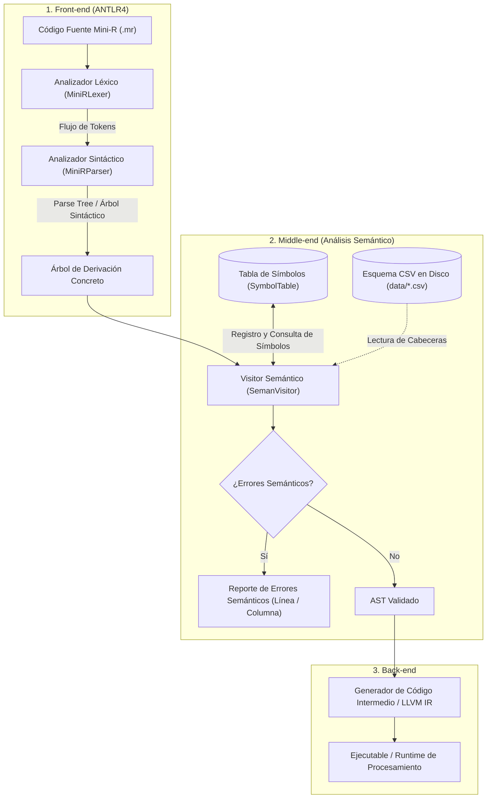
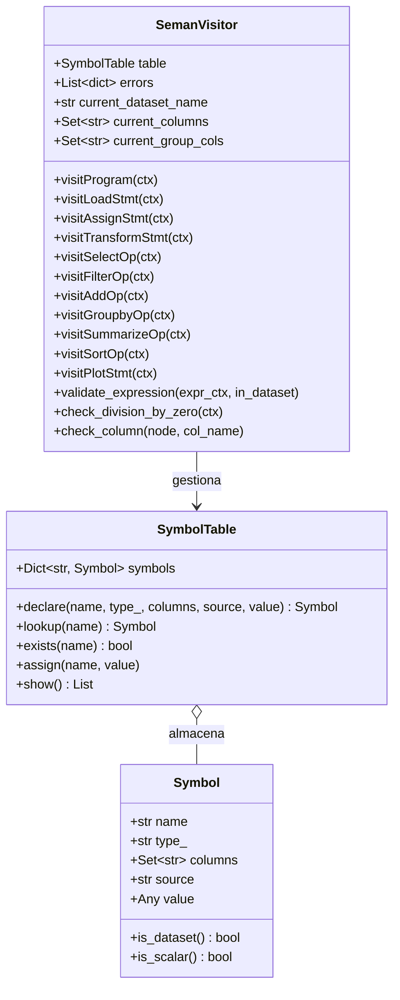

# Arquitectura del Compilador Mini-R

**Curso:** Compiladores  
**Hito:** Segundo Avance (Hito 2 - Semana 12)  
**Lenguaje Diseñado:** Mini-R (DSL Declarativo para Análisis y Visualización de Datos)  

---

## 1. Visión General de la Arquitectura

El compilador de **Mini-R** está diseñado siguiendo la arquitectura clásica de compiladores en tres etapas principales: **Front-end**, **Middle-end (Semántica y Tabla de Símbolos)** y **Back-end**. Su objetivo es procesar scripts declarativos de manipulación y graficación de datos, validando preventivamente esquemas de datos, consistencia dimensional y reglas de tipado estático antes de la ejecución o generación de código.



---

## 2. Descripción de Componentes por Fases

### 2.1. Front-end (Léxico y Sintáctico)
Implementado mediante **ANTLR4** con gramática unificada en `grammar/MiniR.g4`:

1. **Analizador Léxico (`MiniRLexer`):**
   - Transforma la cadena de caracteres de entrada en un flujo continuo de tokens categorizados.
   - Maneja palabras clave (`read`, `dropna`, `filter`, `add`, `select`, `groupby`, `summarize`, `sort`, `plot`), funciones estadísticas (`sum`, `mean`, `count`, `max`, `min`), operadores aritméticos (`+`, `-`, `*`, `/`, `%`), lógicos (`and`, `or`, `not`), relacionales (`==`, `!=`, `<`, `<=`, `>`, `>=`), literales (`INT`, `FLOAT`, `STRING`, `TRUE`, `FALSE`) e identificadores (`ID`).
   - Descarta comentarios de línea (`//`), comentarios de bloque (`/* ... */`) y espacios en blanco (`WS`) mediante la directiva `-> skip`.

2. **Analizador Sintáctico (`MiniRParser`):**
   - Aplica las reglas gramaticales libres de contexto (CFG) para validar la estructura del lenguaje.
   - Resuelve la estructura de sentencias principales (`loadStmt`, `assignStmt`, `transformStmt`, `plotStmt`).
   - Modela las transformaciones encadenadas mediante bloques delimitados por dos puntos (`:`), permitiendo una sintaxis limpia sin sobrecarga visual.
   - Aplica precedencia estricta de operadores en las expresiones mediante ordenamiento de alternativas (operadores unarios > multiplicativos > aditivos > relacionales > lógicos).

3. **Manejador de Errores Sintácticos (`CustomSyntaxErrorListener`):**
   - Desacopla la detención abrupta de ANTLR mediante un listener personalizado en `main.py`.
   - Captura y acumula todos los errores sintácticos con número de línea, columna y símbolo inesperado para reportarlos ordenadamente al usuario.

---

### 2.2. Middle-end: Analizador Semántico y Tabla de Símbolos
El núcleo de validación preventiva de Mini-R se ejecuta en `src/seman_visitor.py` y `src/symbol_table.py`:



#### Funcionalidades Clave del Middle-end:
1. **Patrón Visitor:** Recorre el Parse Tree de forma estructurada sin modificar la representación sintáctica.
2. **Contexto Activo de Transformación:**
   - Durante un bloque `resumen = ventas: ...`, el visitor almacena el `current_dataset_name` y el conjunto mutable `current_columns`.
   - A medida que se ejecutan operaciones como `add(nueva_col = ...)`, la nueva columna se añade al esquema activo para que operaciones posteriores en la misma cadena puedan utilizarla.
   - En operaciones como `select(...)` o `summarize(...)`, el esquema se recalcula según las proyecciones o agrupaciones especificadas.
3. **Inspección de Esquemas Externos:**
   - Al procesar `ventas = read("data/ventas.csv")`, el compilador lee la primera fila del CSV en tiempo de compilación para inferir el conjunto real de columnas disponibles.
4. **Validación de Errores Semánticos (7 errores cubiertos):**
   - **E1:** Uso de datasets no declarados.
   - **E2:** Referencia a variables escalares no declaradas.
   - **E3:** Invocación de columnas inexistentes en el esquema activo.
   - **E4:** Intentar transformar variables que no son datasets.
   - **E5:** Redefinición o conflicto incompatible de tipos (ej: pisar un dataset con un escalar).
   - **E6:** Tipo de gráfico no soportado o falta de propiedades dimensionales obligatorias (`x`, `y`).
   - **E7:** Detección estática de divisiones por cero en expresiones constantes.

---

### 2.3. Back-end (Fase Proyectada - Hito 3)
La arquitectura está diseñada para desacoplar el análisis de la síntesis de código:
- Una vez que el `SemanVisitor` confirma que `len(errors) == 0`, el árbol sintáctico decorado con los metadatos de la `SymbolTable` es transferido al generador de código.
- En el Hito 3, se implementará un `CodeGeneratorVisitor` que traducirá las estructuras validadas a:
  - Generación de código intermedio (LLVM IR / runtime de ejecución en Python).
  - Emisión de instrucciones optimizadas para renderizado de gráficos y procesamiento de tablas.

---

## 3. Estructura Modular del Proyecto

```text
compilador/
├── grammar/
│   ├── MiniR.g4                   # Especificación léxica y sintáctica ANTLR4
│   └── .antlr/                    # Archivos auxiliares de la extensión del IDE
├── src/
│   ├── __init__.py                # Módulo Python principal
│   ├── seman_visitor.py           # Analizador semántico (Visitor completo)
│   ├── symbol_table.py            # Estructura y gestión de la Tabla de Símbolos
│   └── generated/                 # Clases generadas automáticamente por ANTLR4
│       ├── MiniRLexer.py
│       ├── MiniRParser.py
│       ├── MiniRVisitor.py
│       └── MiniRListener.py
├── data/
│   └── ventas.csv                 # Dataset real de prueba para validación de esquemas
├── examples/                      # Batería de pruebas formales (.mr)
│   ├── 01_bar.mr                  # Caso válido: Carga, agregación y gráfico de barras
│   ├── 02_scatter_line.mr         # Caso válido: Filtros, dispersión y líneas
│   ├── 03_hist_pie.mr             # Caso válido: Histogramas y pie charts
│   ├── 04_error_columna.mr        # Caso error: Columna inexistente
│   ├── 05_error_dataset.mr        # Caso error: Dataset no declarado
│   ├── 06_error_variable_no_declarada.mr # Caso error: Variable escalar no declarada
│   ├── 07_error_tipo_invalid.mr   # Caso error: Transformar variable escalar
│   ├── 08_error_tipo_grafico.mr   # Caso error: Tipo de gráfico desconocido
│   ├── 09_error_redefinicion.mr   # Caso error: Redefinición incompatible
│   ├── 10_error_propiedad_plot.mr # Caso error: Propiedad obligatoria faltante en plot
│   └── 11_error_division_cero.mr  # Caso error: División estática por cero
├── docs/
│   └── arquitectura_compilador.md # Este documento de diseño y arquitectura
├── main.py                        # Driver CLI principal del compilador
├── test_grammar.py                # Script de prueba sintáctica y árboles de derivación
├── requirements.txt               # Dependencias del entorno Python
└── README.md                      # Documentación general del repositorio
```

---

## 4. Flujo de Ejecución del Driver Principal (`main.py`)

El flujo de control del compilador se orquesta mediante el siguiente algoritmo:

1. **Entrada:** Recibe la ruta de un archivo `.mr` por línea de comandos (o procesa el directorio `examples/` por defecto).
2. **Lectura:** Carga el código fuente en memoria como un `InputStream`.
3. **Tokenización:** El `MiniRLexer` emite el `CommonTokenStream`.
4. **Parseo:** El `MiniRParser` construye el árbol `program`. Si se registran errores sintácticos mediante `CustomSyntaxErrorListener`, se detiene la ejecución y se reportan con código de salida erróneo.
5. **Pase Semántico:** Se instancia `SemanVisitor(base_path=".")` y se ejecuta `visitor.visit(tree)`.
6. **Resolución:**
   - Si `visitor.errors` contiene elementos, se imprime cada error semántico con formato `Línea:Columna -> Mensaje` y finaliza con código de error.
   - Si no hay errores, se imprime la confirmación de éxito y se visualiza el estado final de la `SymbolTable`.
